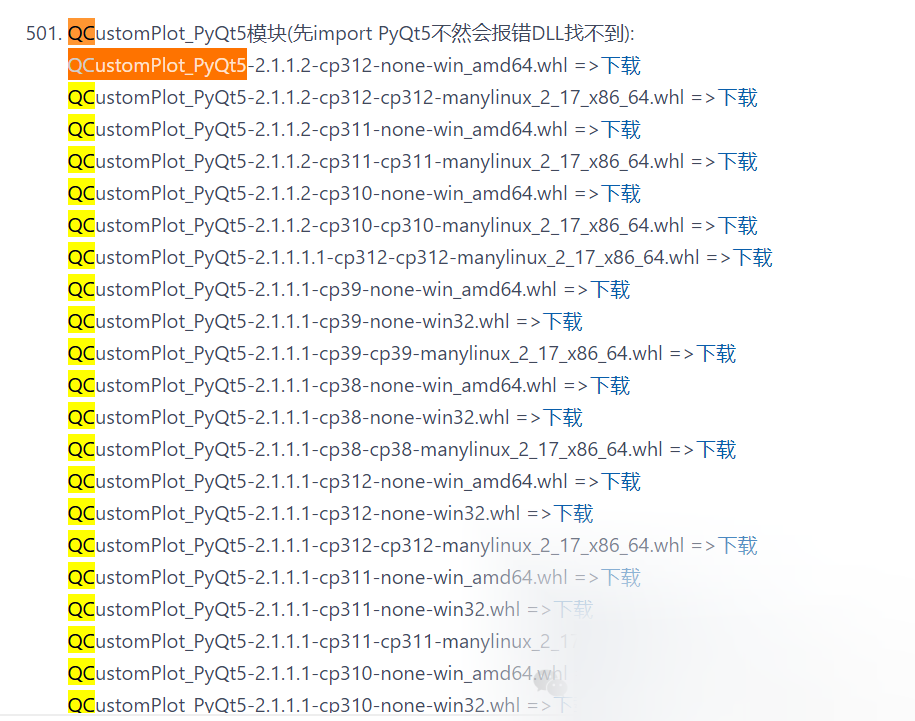

# [python] Windows: Install QCustomPlot_PyQt5 module via WHL file

If you directly try to install QCustomPlot_PyQt5 via pip install QCustomPlot_PyQt5, it will fail or even from source code installation is not possible. Here provides a simple way of whl

To install the `QCustomPlot_PyQt5` module on Windows through a `.whl` file, you can follow these steps:

#### Prerequisites

1.

Python is installed: Ensure that you have installed Python and added it to your system's environment variables.

1.

pip has been installed: pip is typically included with Python installations. If not, ensure it's installed.

1.

(Optional) PyQt5 has been installed: QCustomPlot_PyQt5 depends on PyQt5, so you need to install PyQt5 first. However, since QCustomPlot_PyQt5 automatically installs PyQt5, you do not need to install it beforehand. It is recommended not to install it, as QCustomPlot_PyQt5 will automatically find the appropriate version of PyQt5 for installation.

#### Install .whl files

1.

Download the `.whl` file:

-

Download the `.whl` file of `QCustomPlot_PyQt5` from a reliable source. If you do not have an existing `.whl` file, you can search for it on gitee.com/FIRC/pythonlibs_whl_mirror and download it by pressing Ctrl+F and searching for QCustomPlot_PyQt5.

-



1.

Locate the `.whl` file:

-

Place the downloaded `.whl` file in a known path, for example: `C:\Downloads\QCustomPlot_PyQt5-x.x.x-py3-none-any.whl`.

1.

Install the `.whl` file:

-

1

-

1

-

Open Command Prompt (cmd) or PowerShell.

-

Use the `cd` command to navigate to the directory containing the `.whl` file.

```
cd C:\Downloads

```

-

Install the `.whl` file using pip.

```
pip install QCustomPlot_PyQt5-x.x.x-py3-none-any.whl

```

Note: Replace 'QCustomPlot_PyQt5-x.x.x-py3-none-any.whl' with the actual file name you downloaded.

#### Verification Installation

1.

Start the Python interpreter:

-

Open Command Prompt or PowerShell, enter `python` or `python3` to start the Python interpreter.

1.

Attempt to import module:

-

1

-

2

-

Enter the following code in the Python interpreter to verify if it has been successfully installed, note that you must import PyQt5 first:

```
import PyQt5
from QCustomPlot_PyQt5 import QCustomPlot

```

If there are no errors, it indicates that the installation is successful.

#### Notes

-

Version compatibility: Ensure that the downloaded `.whl` file is compatible with your Python version and operating system architecture.

-

Dependency: If a dependency is missing during the installation process, install the missing dependencies as prompted.

-

Path Issue: If pip prompts for the '.whl' file not found, make sure that the provided path is correct and there are no spelling errors in the filename.

If the above steps fail to successfully install, you may need to look for alternative installation methods or attempt to compile the module from source code, but it is not recommended as failures have been encountered when attempting to compile on Windows.


## Payment

Here is a pay link on Stripe ( https://buy.stripe.com/3cs8yP7sY87d0vu9AB ). Please contact me lonlonago@foxmail.com after funding $89, and I will send you a complete data files , thank you!


